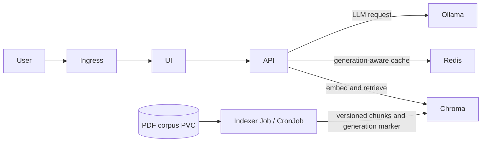

# RAHBAR

RAHBAR is a grounded question-answering service over selected public FAST-NUCES policy and institutional documents. It extracts and OCRs the source PDFs, stores versioned chunks in Chroma, retrieves evidence for each question, and returns an answer with citations or abstains when the evidence is insufficient. The API and UI run on Kubernetes; Redis is reachable only by the API, which changes cache namespaces when Chroma reports a new index generation.

[](https://github.com/wania-Bakhat/Rahbar/actions/workflows/ci.yml)

## Architecture



This workstation's Minikube-to-host Ollama route is `192.168.127.254:11434`; the API URL and both narrowly scoped NetworkPolicy rules use that address. The API uses Ollama for query embeddings and generation; the indexer uses it for document embeddings. If Minikube reports a different host route on another machine or after a network change, update both manifests with the helper script below before applying them.

## Clean clone to a question

Prerequisites: Git, Docker Desktop with its Linux engine running, `kubectl`, Minikube, Python 3.12, GNU Make or equivalent shell commands, Ollama with the configured models, and an LLM API key only if using a hosted provider. On Windows, run the Bash scripts and Make targets from Git Bash or WSL; PowerShell alone does not provide Bash/Make.

```bash
git clone https://github.com/wania-Bakhat/Rahbar.git
cd Rahbar
git switch dev
python -m venv .venv
# Windows PowerShell: .venv\Scripts\Activate.ps1
# Linux/macOS: source .venv/bin/activate
pip install -r api/requirements-dev.txt -r indexer/requirements-dev.txt
make fetch
make cluster
# Configure Ollama's current host IP in both manifests (instructions below).
make storage
make load-corpus
make images
make apply
make index
kubectl rollout status deployment/api -n rahbar
kubectl get ingress -n rahbar
```

Before applying the network policy, find the IP Minikube uses for the host:

```bash
minikube ssh "grep host.minikube.internal /etc/hosts"
bash scripts/set_ollama_network_ip.sh <IPv4-from-the-command-above>
```

The helper updates `OLLAMA_URL` and both Ollama egress CIDRs together. The rule is needed for both API and indexer egress. After Minikube's host route changes, run it again and apply the updated manifests.

### Windows PowerShell commands (without GNU Make)

These commands perform the same setup from PowerShell. They assume Docker Desktop is running in Linux-container mode and Minikube, `kubectl`, Python 3.12, and Ollama are installed. Run the corpus copy script from Git Bash or WSL; it uses Bash and `kubectl`.

```powershell
Set-Location D:\SCD\rahbar-starter\rahbar-starter
py -3.12 -m venv .venv
.\.venv\Scripts\python.exe -m pip install -r api/requirements-dev.txt -r indexer/requirements-dev.txt
py -3.12 corpus/fetch.py

minikube start --driver=docker --cni=calico --memory=6144 --cpus=4
minikube addons enable metrics-server
minikube addons enable ingress
kubectl apply -f k8s/base/namespace.yaml
kubectl apply -n rahbar -f k8s/base/storage.yaml
kubectl wait -n rahbar --for=jsonpath='{.status.phase}'=Bound pvc/corpus-data --timeout=180s

$ollamaRoute = minikube ssh "grep host.minikube.internal /etc/hosts"
$ollamaIp = ($ollamaRoute -split '\s+')[0]
if ($ollamaIp -notmatch '^\d{1,3}(\.\d{1,3}){3}$') { throw "Enter an IPv4 address" }
# From Git Bash or WSL, update OLLAMA_URL and both NetworkPolicy egress rules:
# bash scripts/set_ollama_network_ip.sh <IPv4-from-the-command-above>

# In Git Bash or WSL, from the repository root:
# bash scripts/load_corpus.sh

docker build -t rahbar-api:dev api
docker build -f indexer/Dockerfile -t rahbar-indexer:dev .
docker build -t rahbar-ui:dev ui
minikube image load rahbar-api:dev
minikube image load rahbar-indexer:dev
minikube image load rahbar-ui:dev
kubectl apply -k k8s/overlays/dev
$jobName = 'reindex-' + (Get-Date -Format 'yyyyMMddHHmmss')
kubectl create job --from=cronjob/reindex $jobName -n rahbar
kubectl wait -n rahbar --for=condition=complete "job/$jobName" --timeout=30m
kubectl rollout status deployment/api -n rahbar --timeout=5m
kubectl get ingress -n rahbar
```

The current route is recorded in both manifests so this workspace can reproduce the working Minikube setup. If the host route changes, rerun `scripts/set_ollama_network_ip.sh` with the new IP and reapply the manifests.

Ollama for Windows listens on `localhost` by default, which is not reachable from a Minikube pod. In Ollama's Windows user environment variables, set `OLLAMA_HOST` to `0.0.0.0:11434`, quit Ollama from its taskbar icon, and start it again. This binds the listener to host interfaces: restrict inbound TCP 11434 with Windows Firewall to the Minikube network, and do not add a broad public-network allow rule. The script keeps the API URL and API/indexer egress rules aligned with the host route printed by `minikube ssh "grep host.minikube.internal /etc/hosts"`.

Create any required API key as a Kubernetes Secret, without saving it in Git:

```bash
# PowerShell
$env:LLM_API_KEY = Read-Host "LLM API key"
make secret
# Remove it from this shell after use
Remove-Item Env:LLM_API_KEY
```

For local development without Kubernetes, run `make install` and `make dev`, then open `http://localhost:8000`. This mode uses stub retrieval and an LLM stub; it is for development checks, not corpus evaluation. In the cluster, open the Ingress address with host `rahbar.local`; use `minikube tunnel` if your driver requires it. Ask a question through the UI or call the API:

```bash
curl -X POST http://<ingress-address>/api/ask \
  -H 'Content-Type: application/json' \
  -d '{"question":"What is the minimum CGPA in the current academic rules?"}'
```

## Kubernetes apply order

1. Start Minikube with Calico and enable metrics-server and ingress: `make cluster`.
2. Fetch corpus PDFs, then create the namespace and persistent claims: `make fetch`, `make storage`.
3. Copy local PDFs into the corpus PVC: `make load-corpus`.
4. Build and load the API, indexer and UI images: `make images`.
5. Create the optional hosted LLM key Secret if needed: `make secret`.
6. Apply the dev overlay with `kubectl apply -k k8s/overlays/dev` (or `make apply`). The API/Chroma/Redis/UI services and indexer Job/CronJob are created from `k8s/overlays/dev`.
7. Wait for Chroma, run the indexer and verify the API: `make index`, `kubectl get pods -n rahbar`, `kubectl get ingress -n rahbar`.
8. Ask a question via the UI or `/api/ask` above. Run `make eval` only after the real corpus has been indexed and the configured LLM is reachable.

`make storage` creates the namespace and PVCs first. `make load-corpus` requires the corpus PVC to be Bound. The indexer reads the corpus PVC and writes a new Chroma collection before publishing it through the catalog; it does not connect to Redis. The API observes Chroma's `index_generation` metadata and moves to a new Redis key namespace after reindexing.

## Recovery and rollout evidence

After the cluster is healthy, capture the required pod recovery and rollout evidence:

```bash
kubectl delete pod -n rahbar -l app=api --wait=false
kubectl rollout status deployment/api -n rahbar --timeout=120s
kubectl get endpoints -n rahbar -o wide
kubectl get hpa -n rahbar -o wide
kubectl top pods -n rahbar
```

To show image rollout and rollback, first build/load a second API image tag, then run:

```bash
docker build -t rahbar-api:rollout-demo api
minikube image load rahbar-api:rollout-demo
kubectl set image deployment/api api=rahbar-api:rollout-demo -n rahbar
kubectl rollout status deployment/api -n rahbar
kubectl rollout history deployment/api -n rahbar
kubectl rollout undo deployment/api -n rahbar
kubectl rollout status deployment/api -n rahbar
```

Save the outputs under `docs/evidence/`. Also capture GitHub screenshots showing `main` branch protection and a pull request blocked until its required check/approval passes. Do not fabricate screenshots or cluster output.

## API endpoints

| Method | Path | Purpose |
| --- | --- | --- |
| POST | `/api/ask` | Answer a question with retrieved evidence and citations, or abstain |
| GET | `/healthz` | Process liveness; does not call dependencies |
| GET | `/readyz` | Chroma collection/model and Redis readiness checks |
| GET | `/metrics` | Prometheus request, retrieval, generation, cache, abstention, fallback and provider-reported token metrics |
| GET | `/docs` | FastAPI interactive API documentation |

## Quality checks and evidence

Run `make test`, `make lint` and `make check`. After a real deployment, run `make eval` to produce `eval/results.json`, `make network-test` for allowed and denied paths, and `make evidence` to save timestamped cluster output. Chunk tuning is `python eval/tune_chunking.py --corpus corpus/raw`; failure-mode runs and evidence instructions are in `docs/FAILURE-ANALYSIS.md`. Do not invent result files or screenshots: capture the actual app and cluster state after deployment, and add the screenshot under `docs/evidence/` before submission.

GitHub Actions CI runs for `dev` pushes and pull requests to `main`; CD publishes images on `main` after required GitHub secrets are configured. Protect `main` against direct pushes and merge through a pull request after CI passes. The assignment asks for evidence that the evaluation gate blocks a merge: capture the pull request while the required eval check is failing and the merge control is disabled, fix the failure, then capture the green passing state. Also capture the `main` branch protection settings. These screenshots and cluster measurements must come from the team's own GitHub/Kubernetes accounts.

Before enabling CD, add repository Actions secrets named `DOCKERHUB_USERNAME` and `DOCKERHUB_TOKEN` (a Docker Hub access token, not the account password). In GitHub Settings → Branches, add a rule for `main` that requires a pull request, one approval and the CI checks before merging; disable direct pushes if that option is available. Submit through a pull request from `dev`. To demonstrate the evaluation gate, save a screenshot while the eval check is failing and the merge button is disabled, then fix the failure and save another screenshot after the required checks are green. Save a separate screenshot of the `main` branch protection settings.

## Google Classroom submission checklist

The assignment asks for one submission per team. Before submitting, confirm these items with both partners:

1. GitHub repository URL; make the repository public or add both instructors to a private repository.
2. Link to a successful `cd.yml` run showing tests, image publishing and deployment.
3. Links to the three Docker Hub images tagged with the deployed commit SHA.
4. `eval/results.json` and `eval/baseline.json` committed in the repository, generated from the real deployed stack.
5. Actual app/cluster evidence in `docs/evidence/`, including the requested resource, HPA and endpoint output and GitHub branch-protection/eval-gate screenshots.
6. Completed team review of `docs/AI-USAGE.md` and the personal failure reflection in `docs/ENGINEERING-NOTES.md`.
7. Run `python scripts/check_submission.py` from the repository root and review every warning and failure; the checker is a lint, not a substitute for the PDF rubric.
