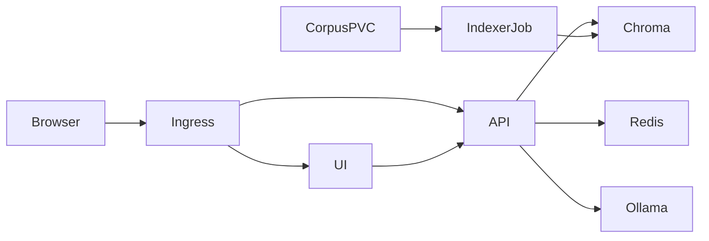

# RAHBAR architecture

## Process and data boundaries

RAHBAR separates the write path from the read path. The one-shot indexer Job and weekly CronJob read the corpus PVC, extract/OCR, clean, chunk and embed each document, and write the resulting vectors and metadata to Chroma. The API Deployment only reads Chroma for user questions. Both read the same `EMBED_MODEL` pin from the `rahbar-config` ConfigMap. An API readiness check rejects a missing/empty collection or a model mismatch.

The UI is served by its own NGINX Deployment. Ingress routes `/` to the UI and `/api` to the API on one host. The API performs semantic cache lookup in Redis, embeds the question using the index pin, retrieves current-version passages from Chroma, constructs a context-bounded prompt and validates the structured model response. It returns citations only when source, section and page refer to retrieved evidence; if evidence is insufficient, it abstains. The API's `/healthz` probes process liveness; `/readyz` checks dependencies. `/metrics` exports request and stage latency, cache, abstention and fallback measures, plus provider-reported prompt/completion token totals. The API logs per-request token counts when the selected provider returns them; the offline stub reports no fabricated usage.

## Why Chroma is a StatefulSet

Chroma is a single persistent vector-store instance with an identity and a durable data directory. A StatefulSet provides a stable pod identity and a per-pod `volumeClaimTemplates` claim so deleting or rescheduling the pod does not discard the index. A Deployment with ephemeral storage could recreate a blank collection after replacement and would not guarantee the required persistent claim lifecycle. The StatefulSet remains one replica because the selected Chroma deployment is a single-node local instance, not a distributed Chroma cluster.

## Kubernetes objects and connections

The `rahbar` namespace contains API and UI Deployments, Chroma StatefulSet, Redis Deployment and PVC, indexer Job/CronJob, four ClusterIP Services, Ingress, ConfigMap, workload-specific ServiceAccounts, NetworkPolicies and API HPA. The API has three initial replicas and scales between three and eight at 70% average CPU utilization. Chroma owns persistent vector data; Redis owns TTL-bound semantic cache records.

NetworkPolicy starts with default deny. Ingress may reach UI and API; UI may reach API; API and indexer may reach Chroma; API alone may reach Redis. The UI cannot reach Chroma. DNS and Ollama egress for both API and indexer are separately allowed because API queries and indexer document ingestion both call the local model host. The checked-in Ollama CIDRs are fail-closed placeholders that must be replaced with the Minikube host's actual `/32` address before a real local-model deployment.

The indexer writes each rebuild to a uniquely named Chroma collection while the catalog still points to the complete previous collection. After inserting and verifying every chunk, it updates catalog metadata to publish the new collection and `index_generation`. API requests resolve that pointer, so new requests use the completed index while in-flight reads can finish against the retained previous collection. On each eligible query the API observes the marker; a change moves the API cache to a new Redis namespace. Redis ingress remains API-only, as required by the assignment NetworkPolicy. Old generation keys expire through their TTL.

## Availability and recovery

API readiness removes a replica from service when Chroma, the collection, embedding pin or Redis is unavailable. The Deployment uses a zero-unavailable rolling update and a pre-stop delay so endpoints can drain. Chroma's StatefulSet PVC preserves its index across pod replacement. Redis uses a PVC for persistence, although cache correctness does not depend on retaining cache entries: entries expire and index-generation namespaces prevent stale answers from being served after reindexing. Scheduled and manual indexer jobs run independently from API rollouts.

The assignment's runtime claims still require cluster evidence: deleted-pod recovery, rollout/undo, three API endpoints, HPA behavior, observed resource use and user-facing screenshot are captured only after a real deployment.
